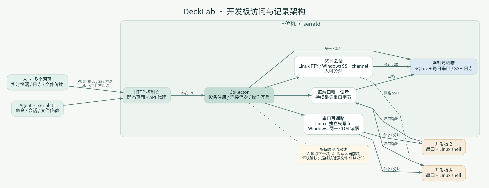

# DeckLab

[简体中文](README.zh-CN.md) · [Installation](docs/INSTALL.md) · [Windows](docs/WINDOWS.md) · [Agent access](docs/AGENT_ACCESS.md)

A shared development-board workbench for OS and BSP developers. Capture serial
output continuously, access boards through a browser or agent, and keep boot
history attached to a stable board identity rather than a changing tty number.



## Why DeckLab

- Share serial and SSH terminals with colleagues and agents, with visible session history.
- Keep per-board logs across reconnects and USB serial renumbering.
- Browse logs by date or boot and compare boots to investigate BSP regressions.
- Transfer files over serial when networking is unavailable, including board-to-board copies.
- Recover a stuck USB serial connection without physically visiting the host where supported.
- Install an Ubuntu service or a native Windows host with three simple access modes.

Ordinary commands should use SSH; use serial for bootloader, kernel and networking
failures. Agent grants are revocable and can be scoped to one board. Runtime
service names, command names and installation paths retain the `seriald` name.

## Install and use

Ubuntu packages are built with:

```sh
python3 tools/build_deb.py
sudo apt install ./dist/seriald_1.4.50_all.deb
```

On Windows, build with Python 3.12 x64 and Inno Setup 6.5+ using
`Build-seriald.cmd`, then run the generated Setup EXE. Upgrades retain runtime
`data/`. Installed users do not need Python. See the Windows guide for download,
LAN access, firewall approval and portable ZIP alternatives.

```sh
python3 serialctl.py --url http://127.0.0.1:8898 devices
```

The web UI can generate agent access instructions with hosted client and skill
links. Serial input is shared; coordinate interactive work with other users.

## Scope

The strongest tested workflows currently use Ubuntu hosts, Windows COM adapters
and Linux development boards, including SpacemiT K1/K3 vendor and upstream
kernels. See the [identity matrix](docs/DEVICE_IDENTITY_MATRIX.md) for verified
board identities. Firmware-only targets and additional serial configurations are
being generalized; unsupported identity sources remain provisional.

The service is intended for local or trusted-LAN development. Authentication is
optional. SSH root provisioning can modify a development board, and SSH host
keys can change after flashing. See [deployment scope](SECURITY.md).

## Contribute

[CONTRIBUTING.md](CONTRIBUTING.md) describes hardware-free tests and module
boundaries. The [optimization plan](docs/OPEN_SOURCE_PLAN.md) tracks work toward
public releases, generic configuration and a hardware-free demo. Do not start a
second collector on active devices.

## License

Application code and original branding: [Apache-2.0](LICENSE).
Bundled and build dependencies retain their licenses; see [THIRD_PARTY.md](THIRD_PARTY.md).
