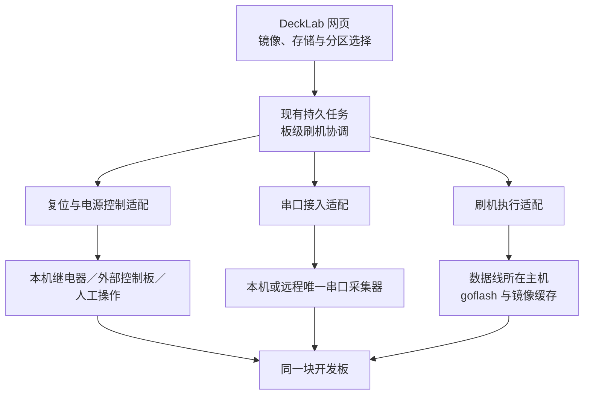

# Configured hardware actions

当前包含固定外部命令适配，以及[本机刷机流程](#本机刷机流程)：开发板已手动进入下载模式后，
可在网页自动检测 USB 下载设备、上传镜像、预览完整镜像或指定分区的写入范围，
并提交持久刷机任务；实际可写范围由已核实的设备能力决定。
复位控制、串口采集和刷写执行保持独立；自动复位与远程／混合节点仍属于
[架构设计](#刷机功能架构设计)的后续工作。软件回归不代表真实板型已完成刷机验证。

Hardware actions are disabled by default. A host administrator can configure
power-on, power-off, reset and an external flashing tool for specific board
serials. This is an adapter interface, not a bundled relay or board flasher.
Linux/POSIX uses an owned process group; Windows 10+ uses a Job Object.
Native Windows runtime validation is a separate release gate, not proven by
Linux mocks. Windows helpers should be EXEs (or an explicit interpreter plus
script), with absolute paths; no implicit cmd.exe or PowerShell wrapper is used.

Set `SERIALD_HARDWARE=/path/to/hardware.json` in the collector environment and
restart the collector when changing configuration. Start with
[`examples/hardware.json`](../examples/hardware.json), replace the board serial
and helper paths, and configure the helper's own relay/programmer mapping.
No configured action runs on service startup, probing or reconnection.

Each action has `argv` (an absolute executable and up to 63 arguments), an
integer `timeout` of 1–3600 seconds (default 60), and optional `allow_agent`
(default false). Optional `exclusive_serial` is a boolean (default false);
set it to true only for helpers that open the board's current serial port.
There is no shell expansion. Argument placeholders are limited
to `{serial}`, `{device}` and `{port}`; clients cannot supply command arguments,
executables or host image paths. Flash images are selected by host configuration
or the configured helper. Credentials and environment are not exposed in task
results. Keep configuration and helper permissions appropriate to the service
account; the application does not run sudo or request elevation.

```sh
serialctl --device riscv-118 hardware
serialctl --device riscv-118 task-start hardware-reset
serialctl --device riscv-118 task <returned-task-id>
serialctl --device riscv-118 task-cancel <returned-task-id>
```

`GET /api/hardware?key=…` lists actions visible to the caller, without executing
anything or exposing argv. `POST /api/task-start` uses `kind=hardware-power-on`,
`hardware-power-off`, `hardware-reset` or `hardware-flash` with the usual expected
serial/connection and actor. Agent grants retain device and actor scope;
configuration must explicitly enable that action for agents. These are trusted
host commands with the service account's authority, not a sandbox.

Independent fixed power commands can operate on an identified offline board.
Commands using device/port placeholders require those attachment fields.
Unidentified boards are rejected. All operations pin identity and generation,
respect input ownership, and acquire the existing console transaction lease;
a file transfer cannot be interrupted by starting a helper. Other devices and SSH readers remain active. Without `exclusive_serial`,
serial capture also remains active and the helper must not open that port.
With `exclusive_serial: true`, the task waits for the existing reader to close
its handle before starting the helper. Discovery cannot reopen that attachment
while the helper owns it. Once helper process-tree cleanup succeeds, capture
resumes on the same connection and archive without flushing pending bytes.
The log records the capture gap; output during exclusive ownership is not
recorded by DeckLab. Disconnect, changed host attachment or service shutdown
prevents resuming the old reader. If helper cleanup fails, the port stays paused;
confirm the external tool is stopped before restarting the collector. This
mode requires an active collector, so it cannot flash a known offline board.

Tasks record progress and exit status/duration. Operation history records start,
completion or stop. Helper stdout/stderr is discarded rather than exposing host
secrets in board history; consult the helper's configured external logging for
its detailed diagnostics. No passwords or argv are persisted in task results.
Timeout, cancellation or identity/connection change terminates the owned Linux
process group or Windows Job, including descendants. Even successful helper exit cleans up
remaining children. A nonzero exit, disconnect during execution or timeout is
reported as failed; cancellation is a request and cannot undo power changes or
a partially written image. Service restart interrupts tasks without replay.

Validate with simulation first. The regression suite launches only local Python
fixtures in temporary directories; it does not invoke relays, real flashers,
serial readers or recovery helpers.

## Linux process ownership

The helper starts in a new session/process group. Cleanup sends SIGKILL to that
group, waits for the root with a three-second limit, then verifies remaining
members have exited before allowing UART capture to resume. Linux checks `/proc`
process and thread states, so an unreaped zombie does not prevent recovery but
a zombie leader with a live thread still does. An unreadable or unobservable
group is not successful cleanup. Other POSIX hosts require the group to disappear
within the cleanup deadline; Linux is the supported/tested POSIX host.

Configured helpers must keep children in the owned group and process namespace,
without daemonizing, changing credentials or hiding members from the collector's
`/proc` view. A process group is not Windows Job-style containment; detached
descendants cannot be tracked by this adapter. Use foreground helper modes.
Normal process-state meanings follow the [Linux proc documentation](https://docs.kernel.org/filesystems/proc.html).

## Windows process ownership

The Windows adapter uses native Unicode `CreateProcessW` with
`PROC_THREAD_ATTRIBUTE_JOB_LIST`, assigning the process before its first thread
can run. A second attribute restricts handle inheritance to a NUL standard-IO
handle; the Job handle is not inherited. `KILL_ON_JOB_CLOSE` provides cleanup if
the collector dies. Normal cleanup terminates the Job, verifies its active
process count reaches zero, waits for the root, and releases handles. If Job
creation/assignment fails, there is no fallback to an uncontained helper. The
Windows command line is limited to fewer than 32767 UTF-16 code units.

See [Microsoft’s atomic Job assignment explanation](https://devblogs.microsoft.com/oldnewthing/20230209-00/?p=107812/)
and [Job Objects](https://learn.microsoft.com/en-us/windows/win32/procthread/job-objects).
Cross-platform tests check ABI widths, attribute/handle ownership, quoting,
failure cleanup, timeout and cancellation. Native Windows tests also exercise
Unicode arguments, root-before-child exit and abrupt collector-helper-owner
termination; the Windows build must run these tests before packaging.

## 本机刷机流程

正常使用已内置执行器的安装包时，打开网页“刷机”即可自动检测本机 USB 下载设备，
不要求先通过串口识别开发板，也不要求手写 `SERIALD_FLASH` 配置。页面显示实际检测到的
下载设备、USB 接线位置和识别状态；选择目标后读取设备能力与可靠的现场分区布局，
再上传镜像、预览范围并开始。复位／进入下载模式仍由用户按板卡要求事先完成。

“已准备镜像”选择文件后可点击“删除所选镜像”，核对名称、大小与 SHA-256 再确认。
它删除服务端暂存的该条镜像并使当前写入预览失效，不修改板卡内容；正在被任务占用、
读取或保留以便恢复的镜像会拒绝删除。仅关闭面板不会删除镜像，不能直接按文件名清理缓存目录。

只有可靠的设备编号与已有档案一致、且不存在身份冲突时，才关联到原板卡。
没有可靠编号的下载设备保留独立 USB 目标及连接代次，仍可在能力允许时刷写；
不会把 USB 端口、COM 编号、用户标签或第一个在线串口当作板卡序列号。
设备重新枚举、换插口或发现身份矛盾时重新检查目标，不自动重复刷写。

自动模式可以读取已运行下载环境的能力，利用可靠 GPT 与现场 `partition-size` 信息
核对指定分区。完整磁盘刷写还要求独立核实的存储容量、逻辑扇区和整盘写入能力；
仅能列出分区不表示可以安全写整盘。缺少这些能力时，页面说明缺失原因，
不能把原始磁盘镜像作为 `rootfs` 分区载荷绕过检查。
无法证明介质和分区命名空间的下载环境（包括部分 NOR／NAND 环境）可以被发现，
但不会据同名分区猜测写入目标；这些设备需要额外的板端能力或经过核实的高级配置。

对于已识别的 SpacemiT K1／K3 BootROM，可上传包含 `partition_universal.json` 的 GPT
刷机包，由执行器从受管缓存中
提取固定的 `factory/FSBL.bin` 和 `u-boot.itb`，核对摘要后生成临时加载方案。
上传和预览不加载设备；开始原任务后才按固定的“加载 FSBL、继续、加载 U-Boot、继续”
顺序准备环境，再读取真实存储布局。指定分区仍在同一个任务内选择、预览并开始写入，
不重复进入模式或重新导入镜像。不完整的包、芯片不匹配或无法核对布局会停止。
这条标准包流程不要求用户编写 JSON；下载设备重枚举仅在原任务占用的固定 USB 接线上接受。
包含 `partition_nor.json` 的 K1／K3 Firmware 包使用独立的 NOR 恢复流程：选择“完整镜像”，
预览包内 `bootinfo/fsbl/env/esos/opensbi/uboot` 六个固定分区与摘要，然后准备临时环境。
现场 `mtd-size` 必须报告受支持的容量；不会使用 GPT、块设备或同名分区猜测 MTD。
加载完成后原任务停在确认界面，重新预览实际写入范围与整片 MTD 的保守擦除风险范围，
点击“确认固件范围并刷写”才执行。`flash:mtd` 会建立分区映射并擦除 `env`，不能保留旧环境；
执行器核对建立后的六个分区大小，再按固定顺序写入。任何失败都不重试、不自动复位。
仅支持标准六分区布局；包内可选 EC 升级明确排除，不执行任意 YAML 或 OEM 动作。
当前下载固件只报告 MTD 容量，不能独立区分 NOR 与 NAND，操作人必须核对板卡使用 NOR；
本流程不适用于 NAND。没有回读摘要能力时不会报告校验通过，刷写成功也不表示启动验收通过。

安装包为受支持的 SpacemiT Fastboot USB 接口提供服务账户访问规则；其他厂商设备
仍受操作系统 USB 权限约束。设备可被枚举但无法打开时，应按显示的权限原因处理，
不要给所有 USB 设备开放写权限。普通流程不会复位设备或启用另一个串口读者。

高级接线、固定板型或非标准临时加载器仍可用 `SERIALD_FLASH` 指定管理员配置文件。
从 [`examples/flash.json`](../examples/flash.json) 开始配置已经登记的板卡序列号、固定 USB 接线、
执行器路径和经过核实的板型描述。该文件是**高级接口示意，不能直接用于任意开发板**：
示例的 `product`、USB 总线／端口和 `getvar` 名称均须按实际下载环境替换、验证。
当前只接受 `control.provider=manual`、本机执行器，以及本机受管串口或 `console.provider=none`。
没有串口也能刷写；有串口时沿用唯一采集器，只做被动观察，不另开读句柄。

刷写执行器使用 goflash 的独立 `decklab-flash` 结构化入口，与旧 `hardware-flash` 固定命令兼容共存。
安装包是否包含执行器由构建输入决定；内置执行器包可以直接使用自动检测。
源码运行或不含执行器的包需要管理员安装对应入口。自动检测不代表已包含临时加载器或所有板型预设。
高级配置的 `flash.argv` 只指向该入口的绝对路径；网页不能传入脚本、参数或主机文件路径。
进入下载模式的手动操作须在开始前完成；本流程不会复位、断电或恢复启动引脚。

在已经取得并确认可用的 goflash 源码中，使用 Go 1.25 或更新版本构建入口：

```sh
go test ./internal/flashplan ./internal/transport ./cmd/decklab-flash
CGO_ENABLED=0 go build -trimpath -o decklab-flash ./cmd/decklab-flash
```

Linux 运行时还需主机的 `libusb-1.0.so.0` 和对已登记 USB 设备的访问权限；
`CGO_ENABLED=0` 不代表不需要运行时 USB 库。将生成文件安装到管理员选择的固定路径，
再填写 `flash.argv`；不从网页自动下载或运行未知程序。Windows 可构建
`GOOS=windows GOARCH=amd64 CGO_ENABLED=0 go build -trimpath -o decklab-flash.exe ./cmd/decklab-flash`，
使用源码中对应 USB 后端及驱动。交叉编译成功不代替 Windows 原生执行验证。
执行器的授权、来源及依赖须单独核对，不能从 DeckLab 的许可推导另一个仓库的分发许可。

镜像导入支持已有刷机包的 ZIP／TAR／TAR.GZ，以及具有可核对 GPT／MBR 的原始磁盘文件和 gzip；
MBR 的逻辑扇区必须由板型明确描述。刷机包只按固定的分区表映射展开范围，不直接执行 YAML
中的任意配方命令；包含 EC 刷写步骤的包拒绝导入。包刷写支持不等于同一板型已支持原始整盘写入。

`profile_data` 的 `identity` 以下载环境真实 `getvar` 值核对设备；每个存储的 `size_getvar` 和
`sector_size_getvar` 核对容量及逻辑扇区。`layout_getvar` 必须返回当前分区数组，每项包含
`name`、`offset`、`size` 和可选实际写入目标 `target`，单位均为字节。例如
`[{"name":"rootfs","target":"rootfs","offset":1048576,"size":1073741824}]`。
这些不是标准 fastboot 必然支持的变量。若板端没有可靠布局查询，可使用管理员核实的
`partitions` 描述配合每分区 `size_getvar`／`offset_getvar` 现场核对；包内分区表不能替代现场布局。
无法核对时停止，并显示具体缺失能力。

在高级自定义配置中从 BootROM 加载临时环境，须另外配置并核实 `profile_data.bootrom_identity`，
例如下载阶段真实支持的 `getvar` 名称到预期值的映射；它与加载器就绪后的 `identity` 分别核对。
BootROM 能响应不表示已经通过存储布局检查，也不能用串口档案编号强行替代下载阶段身份。
没有明确的 BootROM 身份映射时，不自动下载加载器。默认示例未声明这一能力。

示例默认不声明完整磁盘、分区布局更新或回读校验能力。只有实际板端已经验证对应命令后，
才配置 `full_disk_target`、包所需的 `layout_target`／`package_tables` 和
`verify_getvar`（其中 `{partition}` 替换为实际写入目标）。完整刷机包逐项展示全部写入；
原始磁盘镜像必须走明确整盘目标，保留引导区及非分区数据。存在多块可写磁盘时，
用户须通过 `target_storage` 选择目标，不猜测第一块磁盘。
指定分区仅写选中的“存储＋分区”，固定 `write_layout=false`。

网页沿用受管制品上传和后台任务：先上传并核对服务端 SHA-256，生成计划，检查全部范围后开始。
镜像摘要、解包与载荷准备仅使用主机缓存，不占用板卡或 USB；现场检查阶段才短暂占用相应资源，
不会打断原有终端操作。主机准备进程收尾未知时仅保留缓存池恢复占用，阻止新镜像准备；
现场检查或刷写进程收尾未知时才保留板卡及刷写端点占用。
预览不会复位或写存储；需要临时加载器时，计划明确标为准备步骤，由提交后的任务执行。
尚无可靠布局的指定分区任务在 `awaiting-selection` 等待最多十分钟，用户在同一任务内预览并
提交最终选择，不重复准备加载器。加载器就绪后的复核继续使用原镜像缓存和摘要，不重新导入；
从同一刷机包选择分区时，只重查现场布局并限制原候选范围，不重复解包。
任务详情分别保留写入、校验和启动结果。
关闭页面、重复提交或刷新只关联原任务，不自动重刷。当前不自动重启或判断系统启动成功。

无法确认执行器进程已退出时，板、端点、镜像与缓存保留恢复占用；预览失败也会留下
`flash-inspect` 任务。操作者须先在执行主机确认原进程停止，再在页面填写原因、确认释放，
或调用 `/api/flash-recovery`。此确认不改变原失败／中断状态，不证明镜像有效，也不重放命令。
正常结束后的缓存按已有维护周期清理；同一缓存只要仍被未过期计划、活动任务或恢复占用引用就不回收。
清理载荷后仍保留计划摘要及任务回执。

软件测试使用模拟执行器、假 USB 传输、临时文件和隔离浏览器夹具。真实板型、存储介质、
512／4096 扇区、USB 模式变化，以及 Linux／Windows 节点仍须分别留下实测记录；本次未刷写真实板，
也不表示代码已经发布或部署。后续完整拓扑的要求保留在下方设计中。

## 刷机功能架构设计

目标是在 DeckLab 板卡界面提供完整镜像与指定分区刷写。DeckLab 负责板级任务、接线绑定和
操作协调；goflash 负责在刷机数据线所在主机执行传输。复位控制、串口采集、刷机执行分别配置，
三者可以同机，也可以分布在不同设备上。本机手动入模式的网页刷机见上节；此节继续定义
自动控制及远程／混合节点的完整目标，不表示这些节点适配已经实现。

“本机”指 DeckLab 后端所在主机；浏览器所在电脑若连接了硬件，也须运行对应节点程序。
浏览器只提交和观察任务，不负责持有硬件连接。小型控制板只需控制电源、复位或启动引脚，
不要求能运行 DeckLab 或 goflash。

### 现有能力与需要改变的边界

| 当前实现 | 复用方式与缺口 |
| --- | --- |
| Board 与串口连接分离（`seriald_core/models.py`） | 继续以 `Board.serial` 归属板卡、任务和历史；离线板也可恢复，不要求先启动系统或识别一次串口 |
| [持久任务](TASKS.md)与网页任务面板 | 增加 `flash` 任务类型，沿用查询、取消、权限与页面恢复；不新增任务平台 |
| 固定硬件命令（`seriald_core/hardware.py`） | 保留旧配置；增加有类型的控制适配，支持进入下载模式和恢复正常启动 |
| [单连接串口事务](CONSOLE_TRANSACTIONS.md) | 保留现有连接代次检查；另加跨模式的板级维护占用，不能直接把原 `hardware-flash` 当完整流程 |
| [受管暂存文件](TRANSFER_ARTIFACTS.md) | 复用上传、摘要和配额；增加镜像包导入与执行节点缓存，明确大镜像容量预算 |
| goflash 配方与 `FlashOps` | 复用加载器和分块传输；增加可预览、可限制写入范围的结构化计划与事件 |

当前 `HardwareOperation` 固定串口 `connection_id`，变化即停止；刷机预期的复位、下载模式、
临时加载器和系统启动会跨越连接。不能为兼容刷机而全局关闭原代次保护。
现有 helper 丢弃标准输出和错误输出，也不接收用户选择的镜像、分区，须增加专门的刷机执行器。

### 三类连接分别绑定



| 能力 | 提供什么 | 本机与远程的关系 |
| --- | --- | --- |
| `BoardControl` | 查询控制状态、进入下载模式、复位、恢复普通启动；上下电为可选能力 | 可调用本机继电器、连接控制板的串行命令或远程固定服务；前端不选择脚本与命令参数 |
| `SerialEndpoint` | 终端输出、受控输入、启动观察与归档 | 串口在哪里，就由哪里的采集器持有唯一读句柄；远程接入不能再开第二个串口读者 |
| `FlashExecutor` | 发现下载设备、准备加载器、描述存储、执行计划、返回回执 | 通用串行总线（Universal Serial Bus，USB）接在哪台主机，goflash 就运行在哪里；默认不做网络 USB 透传 |

本机实现直接函数调用，远程实现走节点适配；相同能力使用同一接口，不为本机增加网络依赖。
远程节点按需提供一种或多种能力，不能要求只有复位功能的小控制板安装整套服务。
远端串口优先复用 DeckLab 采集代码；中央代理其终端和归档查询，远端采集器仍是原始日志的唯一写入者。
事件以节点、端点、流代次和字节偏移续读；远端保留有界断线缓冲，缺失区间明确显示，不伪造连续日志。
中央可保存任务关联的启动片段，不能把它当另一份完整串口档案。

外部设备若只是网络串口服务器，不运行 DeckLab，则由一个串口适配独占其上游字节流，
接入既有采集与归档链。配置明确由哪一端保存完整日志；不能同时启用两种采集方式。
因此小控制板可以只提供引脚控制和串口转发，完整采集、任务与刷写仍由有运行能力的主机负责。

以下为配置模型示意，不能直接放进当前 `hardware.json`：

```json
{
  "board_serial": "example-board-001",
  "binding_revision": 7,
  "profile": "spacemit-k3-pico",
  "control": {"provider": "remote-relay", "node": "control-a", "endpoint": "channel-3"},
  "console": {"provider": "decklab-serial", "node": "serial-b", "endpoint": "uart-2"},
  "flash": {"provider": "goflash", "node": "local", "endpoint": "usb-slot-4"}
}
```

`endpoint` 是节点管理员登记的稳定接线编号，不是浏览器传入的主机路径。
`usb-slot-4` 在执行主机映射到固定控制器／集线器插口及允许的重枚举关系；
`channel-3` 映射到具体继电器或控制引脚。配置修订后旧计划失效，运行中禁止换绑。
未知或尚未登记的板卡先核实并建立档案，不凭第一个在线端口猜目标。

| 接线场景 | 控制 | 串口 | goflash |
| --- | --- | --- | --- |
| 全在本机 | 本机继电器 | 本机采集器 | 本机 |
| 外部控制板负责复位 | 外部控制板，经固定适配 | 本机采集器 | 本机 |
| 串口也在外部设备 | 外部控制板 | 远程采集器 | 本机，或有 USB 数据线的远程主机 |
| 全在远程工作站 | 远程工作站的控制适配 | 同一远程采集器 | 同一远程工作站 |
| 三处分别接线 | 控制节点 A | 串口节点 B | 刷写节点 C |
| 没有自动复位设备 | 等待人工按键 | 本机／远程／未配置 | 本机或远程主机 |

无串口时仍允许刷写，启动观察显示未配置；无自动控制时显示按键接线说明和等待状态，
只有执行器真正检测到下载设备后才继续。仅有 reset 引脚不代表一定能进入下载模式，
须由板型配置明确是否还需下载启动脚、冷启动或其他已有入口。

### 进入刷机模式由板型配置驱动

板型配置保存进入／退出下载模式的有限步骤，例如：设置下载启动脚、按规定时序复位、
等待设备、恢复启动脚。硬件时序在控制适配内完成，不让浏览器逐次发送 GPIO
（General-Purpose Input/Output，通用输入输出）电平或依赖网络延迟实现脉冲。
若通过串口命令进入加载器，使用原采集连接和串口事务；串口不能作为所有板的强制依赖。

启动脚允许由控制器在检测到模式后释放；需要保持的电平由板型配置指定。
退出、取消和异常路径均调用幂等的恢复普通启动配置；控制器有本地脉冲上限，不能因网络断开
永久拉住复位脚。恢复配置不会擅自掉电或复位正在写入的板子。
控制动作完成只证明动作执行，不能代替下载模式检测。常规系统启动链无须换成 U-Boot；
临时刷机加载器只属于刷写过程，是否写启动固件由计划明确列出。

### 完整镜像与指定分区使用同一写入计划

统一计划描述板型、制品摘要、目标存储、布局动作、每个分区载荷和顺序。
DeckLab 保存任务与计划摘要；goflash 解析包和执行计划，前后端不各写一套分区解析规则。
计划有版本，执行器校验自己支持该版本；执行时不重新选择另一份“最新”镜像。
现场布局未知时先保存镜像解析与用户意图，完成布局核对及分区选择后固定最终计划，
在最终计划确定前不允许向存储写入。

**完整镜像**须识别输入类型，不能把所有文件一律传给 `flash rootfs`：

- 已有刷机包：解析 `fastboot.yaml` 及其引用的分区表、加载器和载荷，展开最终写入清单。
  系统盘完整刷写与启动固件、嵌入式控制器（Embedded Controller，EC）刷写分别列范围，
  系统包默认不附带固件更新。
- 原始磁盘镜像：识别原始文件及支持的压缩格式、源逻辑扇区大小和分区布局；
  执行器支持完整磁盘写入时走明确的磁盘目标，否则由导入器生成布局与逐分区载荷计划。
  后者须保留镜像要求的引导区和非分区数据，不能仅拆文件系统后声称等价写入。
  目标容量、扇区格式或引导区语义不兼容时拒绝，不能默认按 512 字节计算所有设备。
  这是新增能力，现有 goflash 配方能力不能证明原始磁盘镜像已可刷写。

**指定分区**从执行器读取目标当前布局，按“存储设备＋分区”选择，允许上传载荷或从包内选取。
不同磁盘的同名 `rootfs` 必须显示所属存储、容量及分区标识。标准 fastboot 不保证提供统一的
存储／分区枚举接口，需对现有板端增加适配，或使用能核对现场布局的板型描述；拿不到可靠布局就
显示能力缺失，不能把包内分区表冒充现场分区表。

分区选择有两条明确路径：已有可核对的板型描述时允许预选，进入刷机环境后严格检查；
没有可靠描述时，用户先点击“准备刷机环境并读取布局”，明确会复位但不会写存储。
原 `flash` 任务进入 `awaiting-selection` 阶段，读取实际布局后展示分区，用户选择载荷并预览
最终计划，再让同一任务继续。等待期间保留板级占用，不重复创建刷机任务。
默认等待十分钟，可由管理员配置上限；退出或超时先确认没有写入执行，再恢复普通启动配置并
按板型退出下载环境。无法确认收尾完成则保留恢复占用，不无限占板或自动放给下一任务。

指定分区计划固定 `write_layout=false`，仅包含选中分区的写入与必要的模式／存储选择步骤，
不展开完整 `multi_flash`，不隐式重建分区表、不顺带更新另一介质的固件。
布局变化是独立选择，须重新预览完整受影响范围。板端未暴露的介质或分区仍需板级支持，
主机工具不能绕过设备能力限制；任意偏移裸写也应是单独的专家功能。

goflash 需要新增或统一以下入口，名称为拟议契约：

| 入口 | 责任 |
| --- | --- |
| `inspect` | 返回当前模式、设备身份、存储与分区、最大下载大小、校验与完整磁盘能力 |
| `plan` | 导入镜像并展开写入清单，分开只依赖镜像的解析与进入加载器后才能做的目标检查 |
| `execute` | 接收固定计划、载荷引用和设备选择，完整镜像／指定分区共用 `FlashOps` 分块路径 |
| 结构化事件 | 携带阶段、存储、分区、已确认字节、错误与最终结果；保留现有人工命令行复现路径 |

当前单命令 `flash` 整文件读入内存，不能直接当大分区实现；现有 `multi_flash` 还可能先生成
`flash:gpt` 或 `flash:mtd`。这两处均应由统一计划入口替代捷径。
优先以受控 goflash 子进程集成，消费其逐行 JSON（JavaScript Object Notation，JavaScript 对象表示法）
事件；不把 Python DeckLab 强行依赖 Go 插件框架。现有插件可继续供其他宿主使用，
但同步请求／事件流不能代替 DeckLab 的持久任务与断线接续。

### 一次刷机怎样运行

1. **准备镜像**：上传或从已配置来源获取，校验 SHA-256（Secure Hash Algorithm 256-bit，
   256 位安全散列算法），解析镜像范围并预览；镜像复制、下载和解包阶段不占板。
2. **占用与核对**：创建原有任务体系内的 `flash` 任务，固定板身份、绑定修订、镜像与用户意图摘要；
   占用板、刷机端口和实际共享的控制资源，检查已有输入占用、文件传输及恢复任务。
3. **进入下载模式**：启动被动串口观察，执行控制配方或等待人工；在刷写主机检测下载模式。
4. **加载临时刷机环境**：按板型加载必要组件，限定当前阶段允许的设备重新枚举。
5. **完成现场检查**：读取目标存储和布局，核对容量及用户选中的分区。
   已在加载器中的设备可在预览时完成这一步；普通运行状态下不能为“预览”偷偷复位。
   指定分区的实际布局与预选不一致时停止，不自动替用户改选；准备模式等待用户完成实际分区选择。
   完成核对与必要选择后固定最终计划及布局摘要。
6. **刷写与校验**：执行固定清单，只有设备确认成功的块计入写入进度；按实际能力回读校验。
7. **恢复与观察**：恢复启动脚，可按用户选项重启并观察启动；确认执行器已结束、资源已收尾后释放占用。

网页预览写清“将复位／进入下载模式”和全部写入范围。自动流程满足检查后直接推进；
不为每一阶段增加人工确认。目标无法检查、能力不支持或接线有歧义时停止并说明缺什么。
任务结束分别记录 `write_result`、`verify_result`、`boot_result`，例如“写入完成／未提供回读／未重启”，
不能仅用一个成功标记推导系统已经启动。请求的必需校验失败或不可用时任务失败；
可选启动观察失败可以保留写入完成，同时明确报告启动未通过。

### 板身份与重新枚举

板的持久身份、串口连接代次、下载 USB 连接代次是三个不同对象。
任务固定 `Board.serial` 与接线绑定修订，分阶段记录实际的端点和连接代次。
下载模式上报的 SoC 编号、串口号或空编号可能不同于板卡档案编号，须通过板型映射和
管理员登记的接线关系核对；不能要求字符串必须相等，也不能有冲突还继续写。

允许的重新枚举同时受本次任务、固定端口映射、阶段、限定时间及预期设备特征约束。
USB 速度切换可能改变端口路径，使用经过配置／验证的转换映射，不能泛化成“同一集线器第一台设备”。
发现多个候选、异常换板、绑定修订变化或身份矛盾就停止。
不因为 UART（Universal Asynchronous Receiver/Transmitter，通用异步收发器）短暂掉线而
自动取消仍在正确 USB 连接上执行的写入；如果本阶段明确依赖串口响应，则按本阶段条件失败。

### 占用与任务状态沿用 DeckLab

板级维护占用贯穿进入模式、刷写和收尾，跨串口代次仍有效。它复用既有操作协调入口，
阻止同板的其他复位、刷写、文件传输、主动识别、保活和交互输入；被动串口读取继续。
进入维护前检查原输入所有权，不静默抢占另一人的任务。其他板可并行；只有实际共享的
继电器总线、USB 切换器等才扩大资源占用范围，不把整个远程节点一律锁死。
确需外部工具直接打开串口时复用 `exclusive_serial` 的句柄交接与进程退出验证。

`TaskStore` 仍是业务任务唯一状态来源。新增板级任务目标及刷机详情，保留现有
`task_targets` 的串口历史快照，不伪造 `connection_id`，也不改变普通任务的代次约束。
刷机详情持久保存无凭据的计划引用、绑定修订、阶段、执行节点、执行尝试编号和恢复占用。
进度继续使用现有 `phase/done/total`；详细事件单独有界保存，避免塞进 64 KiB 的最终结果。

远端执行器只保存与 DeckLab 任务关联的执行回执和事件游标，不做第二套用户任务队列。
每次有副作用的请求以 `task_id + attempt_id + step_id` 去重，相同编号但输入摘要不同则拒绝；
单纯复用任务编号不足以区别“进入模式”和“复位回系统”。本机也使用同样的执行契约。
共享端点上的本地占用防止其他程序经该节点重入；心跳过期不能释放仍在运行的执行器资源。

### 远程通信与故障处理

远程只需要固定能力调用：查询能力、预留／释放端点、执行／查询／取消原步骤及按游标续读事件。
预留绑定任务和资源，活跃进程结束并完成收尾后才释放；节点重启先核对未结束的执行回执。
执行节点负责受管进程，沿用 Linux 进程组或 Windows Job Object 的清理方式。
已提交且可独立完成的刷写阶段在浏览器或中央网络断开时继续；不依赖浏览器逐块驱动。

| 故障或用户动作 | 处理 |
| --- | --- |
| 网页关闭或刷新 | 通过原 `task_id` 恢复观察，不取消任务、不重新提交 |
| 提交成功但回复丢失 | 以同一请求编号查询原任务；提交端和执行端均去重，不再发一次复位或刷写 |
| 控制节点断线 | 查询原控制步骤；状态未知就停止后续阶段，不盲目补发脉冲 |
| 刷写节点网络断线 | 中央显示执行状态待确认；节点继续已提交阶段，恢复后查询原尝试和事件 |
| 写入明确失败或超时 | 停止后续分区；超时保留结果未知，不重发 gzip 块、不从头自动重刷 |
| 用户取消 | 立即记录请求，停止尚未开始步骤；执行器在可停止边界结束，必要时终止受管进程并标记可能部分写入 |
| 取消暂时送不到远端 | 显示取消待确认，不能先记已取消或释放板给下一任务 |
| DeckLab／节点重启 | 不回放写命令；先查原执行回执，无法确认结束则保留恢复占用，禁止新刷写 |
| 无法确认进程已退出或启动脚恢复 | 保留待恢复状态和原操作引用，不因超时自动释放或断电 |

当前重启恢复会把未结束任务记为 `interrupted`。首版保留这条规则，并为刷机保留独立的
资源收尾记录：中央重新连接只收集原执行回执、完成恢复检查，不自动继续流程或改写任务终态。
网页展示“任务已中断／远端写入仍运行或已完成”的分别结果。需要继续时基于原回执创建明确的新操作，
不是重放原请求。若以后支持中央重启后的原任务继续协调，应另行定义状态迁移并验证。

节点凭据保存在服务端配置；浏览器只引用节点和端点编号。远程使用认证的加密连接，
节点只接受预先登记的能力及受管制品编号，不提供任意远程 shell 或用户指定主机路径。
网页和智能体沿用原授权体系，刷写范围必须覆盖所选板、存储及固件动作；旧 `allow_agent`
配置继续控制旧硬件命令，新刷机能力默认不向智能体开放，管理员按范围启用。

### 镜像放在刷写主机附近

复用现有暂存文件的上传、封存、摘要、占用和配额；为刷机增加用途和包导入结果，
不建立第二套互相矛盾的镜像目录。远程执行器按摘要缓存，写入前本地完成摘要核对。
数据可由浏览器上传、中央转送，或从管理员配置的来源由执行节点下载；下载可单独重试，
设备写入不能按普通下载重试。包解压限制路径、链接和展开总大小，来源校验不能只看文件名。

当前单文件默认上限 8 GiB、总量 32 GiB；完整镜像不能假定适用这些默认值。
按“原包＋解包载荷＋必要转换临时文件”计算节点空间和并行预算，预留完成后再进入刷机模式。
镜像缺件、容量不足或不支持的压缩格式在动板前报错。刷写期间缓存禁止回收；任务释放后沿
现有保留策略清理，任务回执仍保存准确摘要与所写范围。

### 网页交互与接口落点

板卡工具区增加“刷机”，沿用后台任务详情，不新建独立任务中心。面板流程为：

1. 选择或上传镜像，显示已准备状态；切换“完整镜像／指定分区”。
2. 展示板型、复位控制位置、串口位置、刷写位置，缺少能力时给出人工路径或具体原因。
3. 完整镜像展示所有受影响存储／分区；指定分区可逐项选择目标和载荷，默认保留布局。
4. 查看写入清单并开始。首次没有可靠布局时，先明确执行不写存储的准备步骤，
   读出布局后在同一任务里选分区并预览开始，面板显示等待期限和退出入口。
5. 展示阶段进度和串口观察入口，分别显示写入、校验、启动结果；关闭面板后任务继续。

拟议接口只增加领域参数，不接收主机命令：

| 接口或已有入口扩展 | 作用 |
| --- | --- |
| `GET /api/flash-capabilities?key=…` | 返回板卡接线、节点状态、可用镜像类型和检查能力；只查询不复位 |
| `POST /api/flash-plan` | 以受管镜像与模式生成预览，返回 `plan_id`、摘要和待现场核对项 |
| `POST /api/task-start`，`kind=flash` | 接收板身份、绑定修订、计划编号和请求编号；无可靠布局时可明确提交仅准备环境的意图，返回原体系任务 |
| `POST /api/flash-selection` | 对原准备任务提交实际布局摘要、选中分区、最终计划和请求编号；仅接受等待选择的同一任务，不重复进入模式 |
| 现有 task 查询／取消接口 | 恢复进度、查询回执、请求停止；不额外维护一套刷机任务状态 |

提交请求的计划、执行器实际检查结果和最终写入集合必须一致；临时加载器探测需要板端动作时
属于任务阶段，不隐藏在能力查询接口。现有 `artifact-*` 接口承接上传，既有 `hardware-*`
接口继续兼容。现有连接型任务接口不放宽 `connection_id` 校验，只给新板级任务增加对应校验分支。

| 模块 | 实施位置 |
| --- | --- |
| 板级绑定、维护占用与持久详情 | 扩展 `models.py`、`schema.py`、`tasks.py`；与原操作协调统一入口 |
| 完整流程协调 | 新 `flash_tasks.py`，由 `task_actions.py` 接入 |
| 本机 goflash 进程与事件 | 新 `flash_runner.py`，复用硬件模块的进程所有权实现 |
| 控制、本机／远程端点 | 硬件适配与节点通信模块；远程只为实际需要的能力加载实现 |
| 镜像与写入计划 | goflash 增加解析／检查／计划执行；DeckLab 扩展受管制品元数据 |
| 界面与客户端 | 新 `static/flashing.js`，复用 `tasks.js`、`devices.js`，同步中英文文案和命令行入口 |

### 实施顺序与完成标准

| 阶段 | 交付 | 完成标准 |
| --- | --- | --- |
| 统一执行基础 | goflash 错误传播、分块执行、计划和事件；DeckLab 板级任务及接线模型 | 明确失败与超时停止，指定分区只生成选中范围，维护占用跨预期重枚举 |
| 本机完整流程 | 本机控制适配、串口观察、镜像上传、全镜像／分区面板 | 本机继电器与人工入模式都可用；完整刷机包和支持的原始镜像有独立验证，不能用前者替代后者 |
| 远程与混合接线 | 控制／串口／刷写节点适配、执行回执、制品缓存 | 覆盖上方本机、远程和三处分离拓扑；断网查询同一次操作，不重复复位／刷写 |
| 产品收口 | Linux／Windows 打包、能力说明、恢复操作与硬件矩阵 | 软件测试与准确板型实测分别记录，未验证的存储、板型或原始镜像格式不宣称支持 |

验收至少覆盖以下场景，自动测试使用假控制器、假 USB 传输、临时文件和模拟节点，不能操作在用板：

- 同机、远程控制而本机刷写、远程串口、全远程、三节点分离，以及无自动复位的人工模式。
- 串口离线且系统损坏仍可进入恢复；观察缺失不冒充启动通过；正常刷机不创建第二串口读者。
- 完整镜像与指定分区；同名分区位于两块磁盘；512／4096 字节扇区、容量不足和镜像超出下载缓冲。
  指定分区回读证明未修改布局、其他分区或另一介质的固件；原始磁盘镜像验证引导区等非分区内容。
- 超过 8 GiB 的镜像及解包空间预算；远程缓存摘要不符、包缺件和不支持格式均在写入前失败。
- 下载模式、临时加载器和 USB 速度切换；错误板、歧义设备或接线修订变化停止。
- 明确 `FAIL`、回复超时、进程异常和回读不符；不吞错、不记满进度、不继续后续分区。
- 提交丢回执、重复请求、浏览器关闭、节点断网及中央／节点重启；只查询原执行编号，不重复动作。
- 准备、复位、写入、校验各阶段取消；进程与引脚收尾不可确认时保留恢复占用。
- 同板原有输入占用或传输运行中；不同板可并行，共享硬件仅按实际资源协调；权限撤销与范围校验。

实施时按真实板型、控制器、存储介质和节点系统留下独立实测结果；方案完整不等于功能已交付。

## USB 下载目标打不开或模式未知

`target-unavailable` 表示枚举到了所选 USB，但执行器没有成功打开通信会话；
`probe-protocol-failed` 表示只读识别阶段发生通信错误。两者都不能据此判定板型、
分区布局或回读能力是否受支持，也不表示上传的镜像已被解析。
页面展示经限长和去控制字符处理的 `diagnostic`，预览和写入仍被禁止。
上传镜像可仅完成主机暂存；这不会修复 USB 链路，也不会加载 BootROM 环境。

先检查诊断中的权限、占用或 USB I/O 错误。对于 I/O 错误，可由现场操作者仅重新连接
这块板的数据线、尝试直连主机并重新进入下载模式，再在网页重新检测；服务不会自动复位或重发刷写。
[libusb 错误码](https://libusb.sourceforge.io/api-1.0/group__libusb__misc.html) 中的 `-1` 为一般 I/O 错误，不能单凭这个值认定某根线已坏；如底层同时记录
`-EPROTO`（常见编号 -71），可能涉及设备/固件、连接或主控通信故障，需对照
[Linux USB 错误码说明](https://docs.kernel.org/driver-api/usb/error-codes.html) 做现场核对。

## Web 与硬件节点分开部署

现已实现 Web 节点通过认证 HTTPS 连接一个 Windows / Ubuntu 硬件后端；串口、USB 刷机和复位仍在同一后端，`node: local` 均指该后端。参见 [部署说明](DISTRIBUTED.md)。把这三种硬件能力进一步拆成独立节点、或聚合多个后端，仍属于后续扩展。单文件刷分区使用预备 RAM 下载环境，URL 镜像由后端后台下载，不增加新的串口读者或任务队列。
