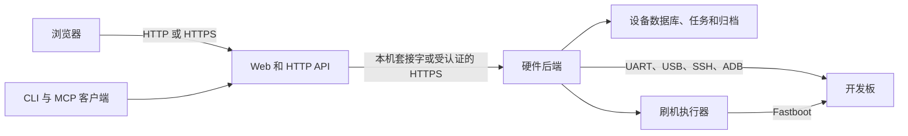

# 架构与模块

DeckLab 把浏览器上的操作交给连接开发板的控制机。浏览器发送操作请求并显示结果，硬件后端管理串口、USB、板卡身份和任务。网页关闭后，后台任务和串口采集继续在控制机运行。

## 进程和通信

在 Linux 单机部署中，Web 和采集服务通过本机套接字通信。在 Windows 单机部署中，主程序管理私有回环连接。分离部署时 Web 节点使用固定 HTTPS 地址、信任的证书和节点令牌访问后端。[分离部署](distributed-nodes.md)

## 模块职责

| 模块 | 所属文件与职责 |
| --- | --- |
| 网页界面 | `index.html` 和 `static/` 展示设备、会话、任务和状态，使用统一的 HTTP API |
| Web 入口 | `decklab_core/control_server.py` 处理 HTTP、访问权限、静态资源和后端转发 |
| 硬件发现 | `devices.py`、`identity.py` 和 `flash_discovery.py` 管理串口枚举、稳定板卡身份和刷机 USB |
| 会话 | `terminal_backend.py`、`sessions*.py`、`adb_session.py` 和 `desktop*.py` 管理共享终端、SSH、ADB 与远程桌面 |
| 刷机 | `flash_tasks.py`、`flash_runner.py` 将镜像检查、设备探测、计划确认和写入串起来，调用固定执行器 |
| 任务和占用 | `tasks.py`、`transactions.py` 和 `board_maintenance.py` 保存原请求、状态、进度和资源占用 |
| 授权和接口 | `agent_grants.py`、`decklabctl.py`、`decklab_mcp.py` 给人和自动化提供受控操作 |
| 配置和存储 | `web_settings.py`、`storage.py` 和 `schema.py` 管理配置、设备记录和数据库升级 |

## 请求如何变成板卡操作

以刷机为例。Web 提交镜像和目标板，后端核对 USB 连接，返回计划和实际目标介质。操作者确认后，原任务持有板卡占用并让执行器写入。串口归档、刷机命令回执和进度来自各自通道，可在同一任务中查看。链接中断时使用原任务编号回查，区分请求已接收、板端已执行和读回验证通过。[刷机工作区](flashing.md) · [后台任务](tasks.md)

以串口为例。采集进程在读取设备前取得独占锁，并在同一描述符上采集。网页终端观察同一屏幕状态。写入使用受控的写入路径，终端尺寸协商、探测和用户输入各自有状态。[终端协调](console-transactions.md)

## 接入现有平台

上层平台持有自己的台账和调度。DeckLab 用稳定板卡序列号和硬件连接核对执行对象，向集成方返回原任务状态和证据。多主机同时控制一块板时，原平台仍需协调外部占用。完整的请求标识、重连、撤销和恢复约定见[平台集成](platform-integration.md)。
