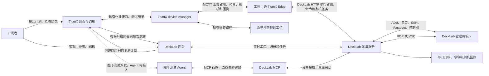

# TitanX 接入 DeckLab

首要场景是由 DeckLab 接管 TitanX 板卡管理。TitanX 调度用例，执行器通过 DeckLab 操作板卡，DeckLab 留下串口和经过其接口执行的命令记录。开发者可在测试时旁观，也可在失败后从 TitanX 原任务跳到同一块板，排查、刷机后再从 DeckLab 触发原用例。TitanX 保留业务工位、用例、调度和测试结果，两边按核实过的硬件序列号关联同一块板。

| 场景 | 谁发起 | 谁执行 | 结果在哪里看 |
| --- | --- | --- | --- |
| 板卡管理和故障排查 | 开发者打开 DeckLab 对应设备页 | DeckLab 上位机采集日志并执行获授权的设备操作 | DeckLab 设备页看现场、日志和操作回执，原 TitanX 测试记录可附设备链接和排查证据 |
| 现有 TitanX 团队用例 | DeckLab 操作者在设备页选板、选用例和轮数 | TitanX 在指定 edge 工位运行现有用例 | DeckLab 任务显示 TitanX 计划和逐轮结果，原执行记录在 TitanX |
| 后续 Agent 图形用例 | TitanX 将已分配工位的用例交给上位机上的 Agent | Agent 调用 DeckLab 远程桌面 MCP，由 DeckLab 截图并向该板发送键鼠 | Agent 将截图、断言和回执归档到原 TitanX 任务 |

DeckLab 网页和现有团队用例接口可用于工位联调。板卡管理组件按工位交接。图形测试需要 TitanX 补齐 Agent、用例调度和结果上传。

同一个 TitanX 实验室可以保留原平台管理的节点，并加入 DeckLab 管理的节点。原节点继续使用原串口坐标和操作入口。当前接入为 DeckLab 工位单独运行 Edge，避免同一个 Edge 进程同时访问两套板卡控制路径。

## 组件与接口



`device-manager` 是 TitanX 的中心设备服务，负责把作业操作发送给工位。Edge 在工位上执行，按工位配置选择 DeckLab 或原板卡管理路径。各自的设备状态和任务回执沿原通道返回。

## 接管板卡管理与故障排查

### 从测试运行到故障复测

1. **派发并关联记录。** TitanX 分配工位，执行器按已核实的板号调用 DeckLab。TitanX 保存原任务、用例编号、轮次与开始时间。通过 DeckLab 后台任务执行的步骤，再保存该步骤的 `request_id` 和返回的任务 ID，让开发者能从一次失败找到对应的板端操作。 [平台调用和占用](platform-integration.md)
2. **运行时旁观。** 开发者打开 DeckLab 对应设备页，查看实时串口、启动归档，以及已关联的 DeckLab 任务和命令回执。网页与测试共用串口采集结果。旁观只读，输入、打开会触发诊断的会话、复位或刷机等操作留到工位交接后。若当前用例由 TitanX edge 直接执行，运行进度和脚本输出从 TitanX 原任务看。 [串口与 SSH](serial-and-ssh.md) · [终端协调](console-transactions.md)
3. **失败时跳到同一块板。** 设备链接用 `#device=SAMPLE-BOARD-001` 指定经过 URL 编码的硬件序列号。失败轮次的链接还携带 `plan`、`job` 和 `record`，例如 `https://decklab.example.test/#device=SAMPLE-BOARD-001&plan=101&job=101_1&record=303`。打开链接后用现有网页认证登录。 [网页分享约定](agent-access.md#按启动读取与搜索)
4. **先留现场，再调试。** 先看占用、实时串口和「历史日志」，按失败时间和轮次保存启动记录。系统卡在固件或内核时从串口判断阶段。确认原用例结束、工位已交接后，再通过 ADB、SSH 或桌面取证和调试。需要刷机时先核对设备、镜像和写入范围。执行后保存回执，用新串口输出和板上读回确认实际结果。 [ADB](adb.md) · [远程桌面](remote-desktop.md) · [硬件控制](hardware-control.md) · [刷机工作区](flashing.md)
5. **在 DeckLab 重跑失败用例。** 从失败轮次进入时，复测请求携带原计划、作业和记录编号。DeckLab 向 TitanX 核对原失败记录属于当前板和所选用例，并把复测与原轮次关联。从普通设备页进入时，可在「用例库 → TitanX 团队用例」选择用例。每次复测生成新的 DeckLab `request_id` 和 TitanX 计划，保留原失败记录和逐轮结果供对照。 [现有团队用例接口](#接入现有团队用例)

### 开发者能查到什么记录

| 来源 | DeckLab 已有记录 | TitanX 接入时怎样关联 |
| --- | --- | --- |
| 串口采集 | 实时输出和按启动、时间查的归档。串口归档记录板端输出，能看到板端回显的输入 | 保留板号、时间和可用的串口游标。经通用串口输入发出的用例步骤，由执行器另存实际命令和判据 |
| DeckLab ADB | 交互会话有独立日志。`adb-command` 任务保存命令、执行时间、标准输出和错误输出摘要、确认的退出码和本次串口位置 | 需要核对具体命令的步骤，通过 `adb-command` 提交并保留原任务编号。输出超出摘要上限时，由用例执行器另存完整产物 |
| DeckLab 本地 Shell 用例 | 运行记录包含实际命令、逐步回读和退出码，可下载原始串口 | 按任务 ID 和轮次获取证据 |
| 现有 TitanX 团队用例 | 从 DeckLab 派发时，任务记录关联的 TitanX 计划和逐轮结果。DeckLab 同时持续采集串口 | 如果 edge 自己打开串口、直接跑 ADB 或执行板上脚本，实际命令和输出由 TitanX 执行器记录。需要在 DeckLab 查到每条命令时，把相应步骤接到 DeckLab 的受管执行接口 |

TitanX 按节点、槽位和物理序列号登记由 DeckLab 接管的板卡。Edge 在接到占用请求时向 DeckLab 申请板级执行权，之后每条受管 ADB 命令都核对本次业务占用编号。命令执行结束后，由 Edge 释放 DeckLab 的执行权。从 DeckLab 用例库发起时，DeckLab 跟踪原计划和逐轮结果，执行权仍由 Edge 申请。仍由原平台管理的工位继续使用各自的映射和占用流程。 [ADB 命令回执及本地用例记录](tasks.md) · [板级占用](platform-integration.md#先占用再执行)

### 怎样从原组件交接到 DeckLab

1. **选一块工位试点。** 双方先记下 TitanX 工位、硬件序列号、串口线、刷机 USB 和电源控制槽位，以及仍会直接访问它们的服务、后台探测和用例步骤。DeckLab 安装在持有串口和 USB 的上位机，按实际接线配置设备。已有控制器可在适配和回读验证通过后继续使用。 [部署方式](distributed-nodes.md) · [控制器配置](hardware-control.md)
2. **在空闲窗口切换控制权。** 让该板在途任务结束，暂停后续派发和其他入口针对该板的探测、自动恢复或刷机。确认原串口进程已实际释放端口，再由 DeckLab 开始采集。接管后同一串口只由 DeckLab 采集，输入经 DeckLab 会话发送。复位、上下电和刷机 USB 在同一时刻也只交给一个执行方。 [终端协调](console-transactions.md)
3. **核对现有用例怎么访问板。** TitanX edge 保留调度所需的工位和用例运行能力。仍直接打开串口、调用刷机 USB 或驱动控制器的步骤，需改走 DeckLab 已有接口，或在迁移期间显式交接控制权。两边确认一方已释放，另一方再接入。同一板的设备管理切换完成后，TitanX 的原板卡管理入口和后台操作应停止直接操作该板。 [平台调用和占用](platform-integration.md)
4. **实测并记录切换结果。** 用开发者的访问身份打开设备链接，核对序列号和日志，再在空闲窗口内验证一个获授权的板级动作，读回板上结果。用同一工位跑一轮约定的现有用例，核对任务结果和控制权归还。若需要回退，先确认 DeckLab 的原任务已结束并释放设备，再恢复 TitanX 原组件的访问。

## 单机安装后接入 TitanX

带有 TitanX 组件的 Linux 工位包支持从一个配置文件启动 Edge、绑定板卡并登记工位。配置示例和首次启动步骤见[单机接入指南](titanx-workbench.md)。

## 登记工位

1. **DeckLab 侧**在设备页确认板卡在线、硬件序列号已核实、身份无冲突，并记录 `serial` 和当前 `connection_id`。先确认串口和 USB 调试（ADB）接的是同一块板。串口连接代次变化后重新读取 `connection_id` 并核对接线。
2. **TitanX 侧**给出板卡登记编号 `code` 和工位 `device_id`（格式为 `edge:槽位号`）。现有团队用例派发要求 edge 与 DeckLab 采集服务在同一台上位机。两侧各核对工位实际接线。DeckLab 通过已授权的设备接口 `GET /api/hardware?adb_binding=1&key=…&serial=…&connection_id=…` 可读回 `serial`、`connection_id`、`usb_port` 和 `boot_id`。TitanX 工位记录中的 `serial` 须与 `usb:<usb_port>` 一致。
3. **优先在 TitanX 档案登记。** 档案提供 `decklabSerial` 和 `decklabSlot` 后，DeckLab 按本板硬件序列号查对应档案，再核对实际 USB 接线。原档案只有设备编号和工位时，可在 `DECKLAB_TEST_PLATFORM_BOARDS_FILE` 指定过渡映射。该文件中的记录优先，每个 `code` 和 `device_id` 各只出现一次。换板后重新核对板号和接线。

```json
{
  "SAMPLE-BOARD-001": {
    "code": "sample-board",
    "device_id": "sample-edge:1"
  }
}
```

TitanX 记录业务工位与 DeckLab 板号的对应关系，DeckLab 记录该板的实际连接。DeckLab 的执行占用只覆盖当前采集服务（`cross_platform_exclusive=false`）。TitanX 调度方和设备操作人员共同确认跨入口交接。 [设备映射和占用接口](platform-integration.md#协商和设备映射)

对于按 RemoteUART 坐标关联档案的 TitanX 环境，在 DeckLab Edge 配置的 `decklab.remote_uart_com` 中按槽位指定从 1 开始的唯一 COM。TitanX 对应板卡档案填写服务器 100 和相同 COM。比如把槽位 1 配为 COM 1，Edge 注册和心跳上报的发布主题为 `serial/cmd/100/1`，订阅主题为 `serial/resp/100/1`。这些字段供 TitanX 匹配档案，受管串口操作仍由 DeckLab 采集器执行。

首次派发前，在 TitanX 设备页核对档案已绑定同一个 DeckLab 板号、状态为空闲、调度为「接受调度」。在 DeckLab 确认这块板的 ADB 身份和板级占用。改过接线、换板或恢复原管理平台后，重新核对这几项，再安排一轮已评审的用例。

| 首轮预检 | 从哪里核对 |
| --- | --- |
| 物理板与接线 | DeckLab 的设备页确认硬件序列号。读取 `GET /api/hardware` 的 `adb_binding`，核对板号、当前连接和 `usb_port`。TitanX 档案的 USB 接线应为 `usb:<usb_port>`。 |
| 档案与调度 | TitanX 的设备档案核对 `deviceId`、`decklabSerial` 和 `decklabSlot`。按 RemoteUART 关联的工位还要核对服务器和 COM。确认状态为空闲且接受调度，再用 DeckLab 的 `GET /api/input-owner` 加 `scope=board` 核对板级占用。 |
| 用例定义 | 在 DeckLab 的「TitanX 团队用例」打开用例详情，或读 `GET /api/team-test-cases?view=detail&id=…` 并带设备身份。核对 `configured`、`mapped` 和 `case.runnable`。首轮选只读用例，同时审查实际执行脚本。 |

已有 Edge 节点和 MQTT 配置时，DeckLab 管理的单板工位可在 Edge 配置中加入以下内容。令牌文件使用 DeckLab 为指定板签发的授权。

```yaml
backend: decklab
slots:
  - id: 1
decklab:
  base_url: https://decklab.example.test
  token_file: /run/decklab-edge/board.token
  slots:
    1: SAMPLE-BOARD-001
  remote_uart_com:
    1: 1
```

Edge 刷机沿用 TitanX 的 `flash/request` 和 `flash/<task_id>/status`。受管请求携带本轮的 `apply_id`。Edge 先导入镜像 URL，若请求附带 `attach.image_sha256`，DeckLab 会在进入下载模式前校验整包。DeckLab 优先按已核实的 USB 接线识别下载设备。如果换模式后换到了系统无法对应的 USB 路径，只有唯一新设备在原板串口返回匹配的校验值时才接受该设备。DeckLab 读回板号后返回目标 ID 和连接代次，Edge 据此生成刷机计划。显式选择 `nvme:0` 等物理盘时，Edge 会在提交前复核计划读回的物理盘，并要求跳过板载嵌入式控制器（EC）更新。刷机结束后回传验证和复位回执。自动发现复用已有下载模式控制，无需额外配置 `DECKLAB_FLASH`。有多个可写目标盘时，需选定目标才可提交。 [刷机 API](../reference/http-api.md#board-level-flashing)

TitanX 内部调用可沿用设备服务的 `POST /device/flash`。请求包含 `deviceId`、`jobId` 和 `imageUrl`，可选 `imageSha256` 和 `targetStorage`。目标盘使用 DeckLab 预览标识，比如 `nvme:0`，不要填写 Linux 设备路径。带可选字段的请求要求工位声明 `managed-decklab-flash`，否则在占用板卡前拒绝。网页排查时也可以直接在 DeckLab 预览并选盘。

## 接入现有团队用例

1. **TitanX 侧**提供 HTTPS 站点和服务身份的访问令牌。该身份需要能读团队目录、查工位、创建和启动计划、按需取消，以及读回任务结果。准备一个已完成自动化的可执行用例，让对应工位在线、空闲且未被其他人领取。
2. **DeckLab 侧**在「系统配置 → 访问与共享 → 团队用例（TitanX）」保存平台 HTTPS 地址和令牌。地址填写站点根地址，例如 `https://platform.example.test`。自动部署可用 `DECKLAB_TEST_PLATFORM_URL` 和 `DECKLAB_TEST_PLATFORM_TOKEN_FILE`，令牌文件仅给采集服务读取。网页保存的地址与令牌优先；更换站点时重新填写令牌。分离部署时在采集节点配置。 [环境变量参考](../reference/environment.md)
3. **DeckLab 操作者**以主访问身份打开设备页「用例库 → TitanX 团队用例」，查看用例前提、步骤和预期结果，选择 `1–100` 轮，再点「在当前板上执行」。未登记工位的设备可以浏览目录。Agent 可以用 MCP 的 `list_team_test_cases`、`get_team_test_case` 和 `run_team_test_case` 查找并执行用例。网页接口可用 `GET /api/team-test-cases` 读用例，在同一主访问身份下调用 `POST /api/task-start`，示例如下。 [目录和任务 API](../reference/http-api.md)

```json
{
  "kind": "board-test",
  "source": "titanx",
  "key": "sample-board-label",
  "serial": "SAMPLE-BOARD-001",
  "connection_id": "<当前连接代次>",
  "case": 123,
  "rounds": 1,
  "request_id": "titan-existing-attempt-001"
}
```

DeckLab 创建一个只含所选板卡、用例和轮数的 TitanX 计划。计划使用板上当前系统，镜像地址留空，关闭测试前自动重启。DeckLab 读回计划并再次核对接线和工位状态后启动。若用例需要指定系统或启动状态，先由设备操作人员准备板卡，再发起测试。TitanX 负责用例本身的动作。 [设备控制](hardware-control.md) · [刷机工作区](flashing.md)

任务历史中的 `result.platform_plan`、`result.platform_task_id` 和 `result.platform_device` 用于两边对账。查看 `result.recent_rounds` 的逐轮状态，DeckLab 会核对这些结果属于原计划、原设备和原用例。只在指定的各轮都通过时记本次用例通过。

提交回执丢失时在网页点「查询原任务」，或以同一身份按保存的 `request_id` 查询 `/api/task`。如果 TitanX 回执丢失，用已记录的计划名或任务编号查原计划。若无法确认原测试已停止，保留板卡占用并由操作人员核实后释放。 [原请求回查](platform-integration.md#一个业务尝试对应一个稳定请求-id)

如果后续由 TitanX 执行器直接委托 DeckLab 做板级操作，可复用 [平台 HTTP 接入](platform-integration.md) 的能力协商、设备映射、占用和任务回执。每项操作先读取对应板的能力，按该操作的授权提交。

## 接入上位机 Agent 图形用例

### 准备上位机和目标桌面

1. **DeckLab 侧**在已识别设备的「桌面」连接设置中保存供该用例使用的 RDP 或 VNC 入口，勾选「允许持有该设备授权的 AI 使用桌面」，用网页核对能看到用例要求的画面，再关闭人工会话。登录用例选登录画面，应用用例选能看到目标应用的用户桌面。远程桌面密码留在 DeckLab 控制机。 [桌面配置](remote-desktop.md)
2. **DeckLab 侧**给这块板签发独立的 Agent 授权。**TitanX 侧**在实际启动 Agent 的上位机进程中注入 MCP 地址和令牌。地址为 DeckLab 服务的 `/mcp`，例如 `https://decklab.example.test/mcp`，传输使用 Streamable HTTP，请求头使用 `Authorization: Bearer <Agent 令牌>`。使用该进程可访问且信任证书的地址。令牌保存在执行器的凭据配置中；模型仅接收用例和公开设备参数。 [MCP 客户端配置](mcp.md)
3. **TitanX 调度方**将业务任务、尝试、用例和工位交给 Agent，并带上已核实的 DeckLab `serial`。Agent 注册工具后先用 `list_devices` 确认目标板，再用 `list_desktop_sessions(device=序列号)` 确认 `supported=true`。首个用例只需开放下表工具和 `list_devices` 给模型。一个板卡同时只持有一个 DeckLab 图形会话。如果会话已被其他人占用，请原操作者关闭后再开始。 [会话和占用](remote-desktop.md#会话观察和输入)

如需在每次图形操作时核验原平台占用，须由双方另行接通 DeckLab 已支持的原控制台占用接口。联调前由 TitanX 调度和设备操作人员按工位约定交接。 [原平台占用约定](remote-desktop.md#原平台占用)

如果 Agent 负责 DeckLab 的板级占用，在打开桌面前调用 `claim_board(device)`，用同一设备授权做图形操作。MCP 会复用该授权下的占用凭据。收尾时先关闭图形会话，再调用 `release_board(device)`。若占用已由 Edge 取得，执行器须在同一授权身份下复用原占用凭据，或由调度方安排交接。不同 Agent 令牌各自代表独立的执行身份。

### 工具顺序与坐标

| 顺序 | 工具和关键参数 | 读取或保存 |
| --- | --- | --- |
| 1 | `list_desktop_sessions(device)` | `supported`、`sessions`、`display_kind` |
| 2 | `open_desktop(device)` | `session.id`，后续作为 `sid` |
| 3 | `capture_desktop(device, sid)` | MCP 文本块中的 `frame.id`、`frame.width`、`frame.height` 等元数据，以及 MIME 类型为 `image/png` 的图片块 |
| 4 | `desktop_input(device, sid, frame_id, request_id, action, …)` | 文本块中的 `task`。默认 `screenshot=true`，画面可取时也返回新帧和图片块 |
| 5 | `get_task(device=…, request_id=…)` 或 `get_task(device=…, task_id=…)` | 按原请求查任务，两个查询 ID 任选其一。输入还在运行时继续查原任务 |
| 6 | `close_desktop(device, sid)` | 结束图形连接并释放它的输入占用。原 TitanX 工位由调度方在确认收尾后释放 |

`device` 使用硬件序列号。`frame_id` 引用同一调用方最近取得的画面，点击坐标是原始 PNG 像素，左上角为 `(0, 0)`，向右、向下为正。`x/y` 必须是整数，范围分别是 `[0, width)` 和 `[0, height)`。`frame.scale` 是配置元数据，按照 PNG 宽高计算点击。DeckLab 网页已经把浏览器画布上的坐标换回截图像素；直接走 MCP 的 Titan Agent 在缩放或裁剪图片后负责换回原图坐标。

例如原图为 `1920×1080`，整图缩小到 `960×540` 后在 `(320, 180)` 选点，调用时传 `(640, 360)`。如果模型看到的是带留白的图，先减掉留白偏移，再按可见图像区域的尺寸换算。如果看到的是一块裁剪区域，再加回该区域在原图中的起点。

```json
{
  "device": "SAMPLE-BOARD-001",
  "sid": "<session.id>",
  "frame_id": "<frame.id>",
  "request_id": "titan-gui-attempt-001-click-01",
  "action": "click",
  "x": 640,
  "y": 360,
  "button": "left"
}
```

拖动使用 `action="drag"`，加上终点 `end_x/end_y`。滚轮使用 `action="scroll"`，带 `x/y` 和 `steps`，正值向下。组合键传 `action="key"` 和 `keys`（例如 `['Control_L', 'a']`），文本传 `action="text"` 和 `text`。每个新动作生成并提前保存一个 `request_id`，使用 8–100 个字母、数字、下划线或连字符。截图更新、显示模式或连接变更后，用新帧重新定位。 [图形操作工具](mcp.md#图形操作) · [图形会话约定](remote-desktop.md#会话观察和输入)

### 判定、取证与收尾

- **按用例预期判定。** 打开会话后先等目标控件出现在截图中，再定位点击。输入工具的回复可能包含 `state=failed` 的后台任务，客户端须检查任务状态。旧帧被拒绝时，任务为 `outcome=not-issued`，先取新图再定位。输入回执的 `outcome=acknowledged` 表示键鼠输入已获确认。以操作后的画面或应用回读判定实际效果，例如打开应用菜单后看到应用列表，或在输入框提交后看到约定的确认内容。若动作后的第一张截图未显示预期变化，在用例时限内继续截图观察原动作。
- **按原步骤恢复。** 传输超时先按原 `request_id` 查询。若回执仍未知，保留原任务并查看新画面，禁止自动重复点击。若打开会话的回执丢失，用 `list_desktop_sessions` 查该授权的会话。换板、占用冲突或无法确认清理时，将原任务交给设备操作人员处理。
- **在 TitanX 归档。** 建议保留任务和尝试编号、用例版本、设备序列号、`sid`、各步 `request_id` 或 DeckLab 任务 ID、关键前后截图以及逐步预期和实际结果。截图和输入回执由 Agent 上传到对应 TitanX 任务。跑完或中止后关闭自己打开的图形会话，再确认工位可以交接。虚拟远程桌面可验证系统界面与应用，物理接屏、显示热插拔或固件界面仍按工位的物理测试条件验收。

## 联调验收

| 场景 | 第一次联调的验收条件 |
| --- | --- |
| 测试、旁观、排查和复测 | 接管单个工位，安排一个有明确通过和失败判据的用例。运行时从另一网页读取同板串口，查看一条受管命令的实际命令、回执和输出。失败后从 TitanX 跳回同一板，留存原证据，经交接做一项获授权的调试动作，再从 DeckLab 触发同一个用例。核对复测是独立任务，且能与原失败关联。 |
| 现有团队用例 | 在一个已登记的空闲工位发起一轮已完成自动化的可执行用例。DeckLab 和 TitanX 查到同一计划、设备和轮次，逐轮结果一致，完成后工位可交接。 |
| Agent 图形用例 | Agent 从上位机连到目标板，截取操作前画面，点击一个已约定的控件并观察到预期变化。TitanX 可回看前后 PNG 和对应任务回执，最后确认会话关闭。用例涉及拖动或文字输入时，分别增加对应画面或应用结果。 |
| 异常处理 | 在隔离环境覆盖工位与接线不符、旧截图和输入回执丢失。结果应能定位到原设备和原请求，且不会重复执行或错用其他板。 |

可先运行隔离合同测试核对现有派发和桌面回执。桌面 MCP 图片测试需要安装 `requirements-mcp.txt` 中的依赖。真实工位通过以上联调后，再登记 TitanX 侧的接入结果。

```sh
python3 -m unittest discover -s tests -p test_team_cases.py
python3 -m unittest discover -s tests -p test_desktop.py
```
