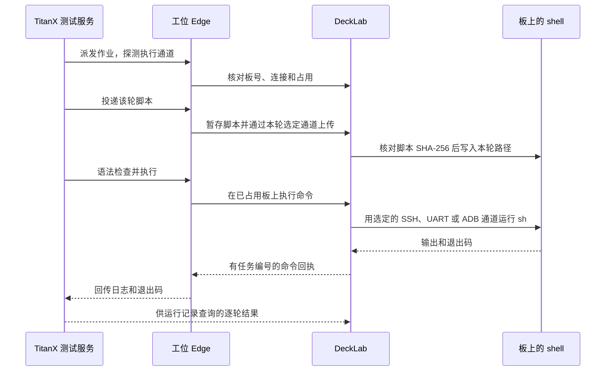

# 单机安装后接入 TitanX

Linux 内网工位安装包自带 TitanX Edge 和配套 case-cli。安装信息文件 `/usr/lib/decklab/installation.json` 中的 `titanx_worker` 为 `true` 时可使用此入口。先在 TitanX 分配唯一节点 ID 和服务器 100 下的 COM 号段。已有同名 Edge 的工位在空闲时停止原实例，避免两个客户端抢占同一节点。

## 从用例库初始化

使用主访问凭证打开「用例库 → TitanX 团队用例 → TitanX 工位接入」。还没有选中设备时，也可从「系统配置 → 访问与共享 → 团队用例」打开同一窗口。

1. 填写 TitanX HTTPS 地址和令牌，点击「读取实验室」，从账号可见的列表中选择一个实验室。
2. 填写该实例的唯一节点 ID 和 MQTT 地址。如果消息服务器允许匿名连接，用户名和密码留空。如果要求登录，展开「MQTT 认证」并填写实验室管理员分配给工位的凭据。
3. 列表默认勾选本实例当前全部身份已确认的板卡，包括离线板。检查槽位、起始 COM 和项目类型。混合工位可逐板覆盖默认项目，也可取消仍由其他平台管理的板。
4. 点击「初始化并登记」。每块勾选的板固定一个槽位，在同一节点、同一实验室下分别建档。离线板在上线并核对本机板号、USB 接线和平台上报的槽位及 COM后建档。点击「刷新登记状态」从 TitanX 回查每块板的档案。

网页配置由服务以私有文件保存到 `/var/lib/decklab-workbench/titanx.json`。已经使用系统配置文件的工位也可在此维护。平台令牌与 MQTT 密码不会在状态页和系统配置导出中回显。

## 跟着一块板读代码

设一台控制机的节点 ID 是 `bench-01`，第二块板的序列号是 `SAMPLE-BOARD-B`，起始 COM 是 1。按下面三个动作读代码，可以把界面里的同一块板一路追到测试结果。

1. **在 DeckLab 添加板卡。** 网页提交序列号、项目和预览的槽位、COM。服务端回查本机板号、实验室已有记录和占用状态，保存分配。工位准备程序给这个序列号签发设备级授权，自动生成 `backend: decklab` 的 Edge 配置。Edge 从 DeckLab 查询这块板的在线状态和已核实的 USB 路径。仅串口可用时可经 UART 上传并执行脚本。ADB 命令需要可用的 ADB 连接。此时 `bench-01:2` 指向这块板，RemoteUART 地址是服务器 100、COM 2。从 `static/titanx-setup.js` 的 `addForm.onsubmit` 开始，依次看 `decklab_core/titanx_setup.py` 的 `add_board` 和 `decklab_core/titanx_workbench.py` 的 `prepare`。
2. **在 TitanX 看到板卡。** 工位上的 Edge 连接 MQTT 消息服务器，上报节点、槽位和设备状态。每轮发现共用一份 ADB 设备列表，同一 USB 调试连接在本轮只读一次身份，每块板仍使用自己的授权。下发 ADB 命令时，重新读取板号、当前连接和 USB 绑定。与此同时，DeckLab 登记服务用平台令牌，通过 HTTPS 查询 TitanX 的待建档设备，对齐槽位、COM 和板号或 USB 接线，再调用 `/deviceBoard/add`。一个常见现象是能看到心跳，但建档返回 403。此时要查平台账号的新增板卡权限。在 `decklab_core/titanx_enroll.py` 的 `enroll` 中，从 `reports` 跟到 `create_once` 就能看到这些检查。
3. **从 DeckLab 运行一个团队用例。** DeckLab 找到当前板的 TitanX 档案，通过 `/taskInfo/saveOrUpdate` 创建固定目标的计划，再调用 `/taskInfo/start`。TitanX 中心侧通过 device-manager 把作业操作发给 Edge。Edge 按槽位找到板号和设备授权，向 DeckLab 提交受管 SSH、ADB 或串口命令。DeckLab 保存板端输出和退出码，Edge 回传执行结果，DeckLab 再向 TitanX 查询每轮测试记录。在 `decklab_core/team_run.py` 读 `start` 和 `verified_records`，在 `decklab_core/adb_tasks.py` 读 `BoardCommand`。

### 一条板端 Shell 用例如何完成一轮

以查询 Debian 软件包信息为例。用例库保存编号、名称、执行条件、步骤和预期结果。自动化 Shell 用例还要关联脚本。测试计划选定设备、用例和轮数，平台为设备建立作业，为每轮生成独立的运行编号。下面是板端脚本的执行路径。



- 每轮读取一次脚本。板端 Shell 执行器创建工作目录，上传脚本，执行 `sh -n`，再以 `sh` 启动脚本。环境变量包括 `CASE_CODE`、`CASE_RUN_ID`、`CASE_DEVICE_ID` 和 `CASE_RUNNER`。执行器在结束时尝试删除板上的临时脚本。选择节点执行的脚本走节点执行器。
- 脚本上传跟随本轮指定的 SSH、UART 或 ADB 通道；未指定传输通道时沿用 ADB。SSH 优先使用本板在 DeckLab 连接成功后保存的账号。没有保存记录时使用作业提供的账号，两处均无账号时使用适用的板卡默认配置。保存的账号失效时，在本板「SSH 设置」重新连接并保存。作业凭据只在内存中使用。DeckLab 通过已核实的 USB ADB 取得 SSH 主机公钥；ADB 无法建立绑定时，在已占用的串口核对板号、启动编号和公钥，再通过 SSH 登录。板端 shell 在执行命令前再次核对板号和启动编号。每条命令独立运行，同一脚本内的变量和工作目录按普通 shell 规则保留。
- SSH、ADB 的回执分别记录标准输出和标准错误，各保留前 4096 字节及截断字节数。UART 保存合并的控制台输出。Edge 轮询命令回执、逐行回传，遇到截断会报告错误。同期串口归档用于对照内核、重启等现场事件。
- 脚本可输出 `##CASE_RESULT##` 加一行 JSON，带本轮 `run_id`、`result` 和可选诊断。平台采用本轮有效标记。标记缺失或无效时按退出码判定，0 表示 PASS，2 表示 NA，3 表示 NT，其余表示 FAIL。在 DeckLab「用例库 → 运行记录」选择轮次，可以核对脚本、实际通道、退出码和平台判定。

需要 root 密码登录的镜像，可在本板「SSH 设置 → 需要 root 密码登录？」打开 ADB 配置命令，执行后回到设置验证并保存账号。如果 ADB 不可用，通过串口用镜像提供的登录账号进入 shell，按同一窗口的步骤配置。[ADB 和串口配置说明](../reference/environment.md#manual-root-ssh-setup)

### 从运行记录核对一次执行

在板卡的「用例库 → 运行记录」选中轮次。「本轮执行过程」按回执时间列出创建目录、上传与校验、语法检查、实际执行和清理。展开一步可见命令、通道、板端退出码、输出及 DeckLab 任务编号。历史上传通过板号、执行者和这一轮的唯一脚本路径关联。缺少回执的阶段显示为未记录。有作业占用记录时，网络准备和通道探测也会按同一板号、工位执行者和占用编号列出，并标为「同次占用」。缺少这些关联信息的旧记录不能据此还原探测过程。

- **输入**。Edge 接收本轮脚本字节，将其暂存在 DeckLab，再交给所选通道的上传命令。回执记录输入字节数、SHA-256 和最多 64 KiB 的脚本预览。板端上传命令校验 SHA-256 后将临时文件改名为本轮脚本。执行脚本时，命令行包含实际脚本路径和本轮环境变量；普通执行命令的标准输入连接到空设备。
- **SSH 和 ADB 输出**。命令使用非交互 shell。采集器分别读取标准输出和标准错误，按流保留前 4096 字节和省略字节数。Edge 在轮询时逐行上报；超过保留上限会报告输出截断。采集器从命令结束标记取得板端退出码。断连或超时时，缺少结束标记的回执表示结果未知。
- **串口输出**。输入文件通过同一串口分块传送并校验。执行命令时，shell 和内核共享控制台，标准输出与标准错误合并显示。采集器用每条命令独立的起止标记和退出标记划定输出。同期串口归档按该轮时间另取，可用于对照驱动或重启消息。SSH 或 ADB 执行的输出应在相应命令回执查看。
- **脚本内部**。脚本输出的文字进入相应通道。脚本内部重定向到文件的内容，需要脚本主动打印或另行采集；命令回执记录外层 shell 调用，脚本源码和实际输出分别展示。

## 在网页维护工位

选中目标板卡，打开「用例库 → TitanX 团队用例 → TitanX 工位接入」。在「系统配置 → 访问与共享 → 团队用例」打开时，可以从整个工位选板。

- **添加板卡**。选择一块已确认身份的板卡，核对项目、槽位和 COM，点击「接入当前实验室」。窗口沿用工位的连接信息，自动跳过目标实验室中已占用的 COM。离线板在上线并核对接线后登记。
- **暂停和恢复**。点击板号旁的「暂停接入」可释放该板的 Edge 授权。TitanX 档案、测试历史、槽位和 COM 均保留。「恢复接入」会为同一板号重新授权。暂停所有板卡时，执行器停止运行。
- **维护连接**。展开「维护工位连接」可更新平台令牌、MQTT 连接与新增板卡的默认项目和调度选项。密码或令牌留空会沿用原值。修复连接后可点击「重新连接并核对登记」，再刷新查看平台状态。
- 修改会重新连接当前工位的 Edge。工位有占用时，等待作业释放后提交。网页调整以私有文件保存在工位，使用系统文件安装的工位也可直接从网页维护。

## 通过系统文件部署

在工位创建 `/etc/decklab/titanx.json`，文件属主为 `root:decklab`，权限为 `0640`。可先写到同目录临时文件，设置属主和权限后再改名。单板示例为

```json
{
  "node_id": "bench-01",
  "broker": "ssl://mqtt.example.test:8883",
  "first_com": 1
}
```

需要 MQTT 认证时加入 `username` 和 `password`。需要在 DeckLab 查看用例、重新派发时，可以在同一文件填写 `api_url`（TitanX 的 HTTPS 根地址）与 `api_token`。已有网页团队用例设置或平台环境变量仍优先使用。平台令牌只供 DeckLab 查询和派发使用。

需要自动建档时，在同一文件加入以下字段。平台账号须有实验室的节点和板卡读取、新增权限。`lab_id` 为 TitanX 实验室编号，`project` 为项目类型。

```json
{
  "node_id": "bench-01",
  "broker": "ssl://mqtt.example.test:8883",
  "api_url": "https://titanx.example.test",
  "api_token": "<平台服务令牌>",
  "lab_id": 1,
  "project": "K1",
  "accept_dispatch": true
}
```

登记服务会核对 Edge 在 TitanX 上报的板号、槽位和 COM，再创建档案。新档案默认关闭自动恢复；`accept_dispatch` 缺省时关闭自动调度。已匹配档案沿用管理员的调度设置。匹配的已有节点和板卡直接复用，编号或接线冲突时停止登记。通过 `journalctl -u decklab-titanx-enroll.service` 查看结果。登记响应中断时，服务保留本次提交记录；登记服务自动回查原档，重启后也沿用同一记录。若平台确认未建立该记录，可移走数据目录内的 `titanx-enroll-pending.json` 再重试。

首次保存配置后，systemd 自动启动工位。单板工位自动绑定首次确认的板号到槽位 1，之后重启沿用原板号。多板或换板时显式填写 `"slots": {"1": "SAMPLE-BOARD-A", "2": "SAMPLE-BOARD-B"}`。只列要接管的板，其他板继续由原平台管理。槽位 N 的 COM 为 `first_com + N - 1`。DeckLab 逐板签发设备授权，生成 Edge 配置。配套的 TitanX 设备服务会为该工位的 PC 用例选用随包的 case-cli。

运行 `systemctl status decklab-titanx.service` 查看连接状态。已有配置改动在作业释放后用 `systemctl restart decklab-titanx.service` 应用。停用时在空闲窗口移走配置并停止该服务，撤销对应设备授权。TitanX 档案登记、接受调度与失败轮次的回链依赖平台侧的接口和权限。


## 在指定板卡执行团队用例

TitanX 可将计划指定到已登记的板卡。也可以在 DeckLab 选中板卡，从用例库选择已完成自动化的团队用例并运行，待评审和评审中的用例也可以执行。DeckLab 会在 TitanX 创建固定到该板的计划，回查实际派发的设备、用例和逐轮结果。关闭自动调度的工位仍可接收显式指定到本板的计划。

板端 Shell 用例沿用 TitanX 的执行协议。Edge 为每个作业占用对应的 DeckLab 板卡，按 TitanX 为本轮选定的 SSH、UART 或 ADB 通道上传脚本并执行，作业结束后释放。作业准备阶段可以独立使用 ADB。单个脚本中的工作目录与环境变量由该脚本的 shell 维持，每条外层命令各自启动 shell。Edge 会续期板卡占用。受管命令支持 TitanX 的七天等待上限，命令退出即返回。一个计划可以包含多个作业和多块板卡。
